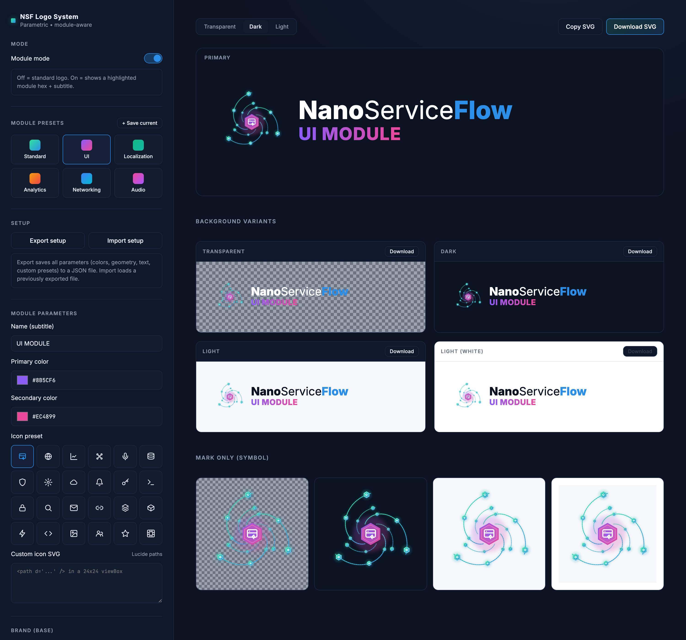

# NanoServiceFlow — Parametric Logo System

[](https://github.com/aim4code/nanoserviceflow-logo/actions/workflows/pages.yml)

**[▶ Open the live tool](https://aim4code.github.io/nanoserviceflow-logo/)**

A **single-file, zero-dependency web tool** for generating the
[NanoServiceFlow](https://github.com/aim4code/nanoserviceflow) brand logo and its
per-module variants. Everything — UI, geometry math, and the
SVG renderer — lives in one self-contained HTML file that runs entirely in the
browser. There is **no build step, no server, and no package manager**.



## Purpose & background

This tool was created to provide a logo for the
[**NanoServiceFlow**](https://github.com/aim4code/nanoserviceflow) library and,
just as importantly, to give **a consistent look across all the different module
libraries that extend it**. Rather than hand-drawing a separate mark for each
module, the logo is generated parametrically so every module shares the same core
identity while getting its own color, icon, and name.

It was also an **experiment** to explore two things:

- The capabilities of the **Claude Design** tool.
- How to build a **parametric design system** that grows outward from a single,
  "simple" but central element — the logo — into a family of coherent variants.

## What kind of project is this?

- **Type:** Static client-side web application (design/brand tooling).
- **Stack:** Plain HTML + CSS + vanilla JavaScript. No frameworks, no bundler.
- **Runtime:** The browser. All logo SVGs are generated on the fly in JS.
- **External requests:** Only Google Fonts (Inter / JetBrains Mono) via CDN. With
  no network the tool still works; text simply falls back to system fonts.
- **License:** MIT (see [`LICENSE`](LICENSE)).

## Features

- **Standard & Module modes** — a base logo, or a highlighted "module" hex with a
  subtitle for product sub-brands (UI, Localization, Analytics, Networking, Audio…).
- **Module presets** — quick swatches, plus **+ Save current** to store your own.
- **Brand & module colors** — gradient start/end and module primary/secondary pickers.
- **Icon picker** — built-in Lucide-style icons or paste custom `<path>` SVG.
- **Geometry controls** — sliders for logo size, core module size, glow intensity
  and reach, arm inset and length, mini-module size and count, and the two text sizes.
- **Background variants** — Transparent / Dark / Light / White, each downloadable.
- **Mark-only (symbol) grid** — the icon on its own across the same backgrounds.
- **Export** — **Copy SVG** or **Download SVG** for any variant.
- **Setup export/import** — save every parameter (colors, geometry, text, custom
  presets) to a JSON file and reload it later.

## Usage

### Quick start (no tooling)

Open the file directly in a browser:

```bash
open "NanoServiceFlow Logo.html"       # macOS
# or just double-click the file in your file manager
```

### Run via a local server (recommended)

Serving over HTTP avoids any `file://` quirks and lets Google Fonts load cleanly:

```bash
python3 -m http.server 4173
# then visit http://localhost:4173/NanoServiceFlow%20Logo.html
```

Any static server works (`npx serve`, `php -S localhost:8000`, etc.).

### Working with the tool

1. Toggle **Module mode** for a sub-brand logo, or leave it off for the base logo.
2. Pick a **preset** or set **colors**, **icon**, and **module name**.
3. Fine-tune with the **Geometry** sliders.
4. Choose a background (top toolbar) and **Copy SVG** / **Download SVG**, or grab a
   specific **Background variant** / **Mark only** cell.
5. Use **Export setup** to save your configuration; **Import setup** to restore it later.

## Project structure

```
.
├── NanoServiceFlow Logo.html   # the entire application (UI + renderer)
├── docs/
│   └── screenshot.png          # tool screenshot used in this README
├── .claude/
│   └── launch.json             # optional: local static-preview config
├── LICENSE                     # MIT
├── CHANGELOG.md
├── README.md
└── .gitignore
```

## Deployment

The tool is published automatically with **GitHub Pages**.

Every push to `main` triggers the [GitHub Actions deployment workflow](https://github.com/aim4code/nanoserviceflow-logo/actions/workflows/pages.yml), which publishes the current version of the tool.

**Live demo:** https://aim4code.github.io/nanoserviceflow-logo/

There is no separate build pipeline: the workflow copies the self-contained HTML
application to `index.html` and deploys it as a static GitHub Pages site.

## Development

There is nothing to compile. Edit the HTML file and refresh the browser. The
renderer (`buildMark` / `buildLogo`, the geometry sampling, and the render loop)
is the inline `<script>` at the bottom of the file.
